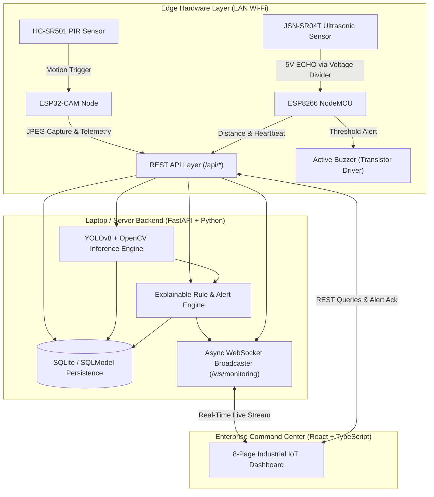

markdown
# 🌊 JEEVA GANGA
### *Intelligence That Protects Life.*

**An AI-Enabled Multimodal IoT Framework for Early Detection of Potential Water Emergencies**

[](https://www.python.org/)
[](https://fastapi.tiangolo.com/)
[](https://reactjs.org/)
[](https://www.typescriptlang.org/)
[](https://tailwindcss.com/)
[](https://ultralytics.com/)
[](https://www.espressif.com/)
[](https://www.arduino.cc/)

---

## 📖 Overview

**JEEVA GANGA** is an industrial-grade, multimodal IoT and edge-to-cloud AI monitoring platform engineered to detect early signs of potential water hazards around rivers, ponds, reservoirs, and swimming zones. 

Instead of relying on error-prone single-sensor alarms, JEEVA GANGA fuses **computer vision (YOLOv8)**, **passive infrared (PIR) motion sensing**, and **waterproof ultrasonic level telemetry** into a unified, real-time monitoring dashboard. Edge microcontrollers handle lightweight sensing and frame capture, while a local FastAPI server executes AI inference, evaluates explainable safety rules, persists telemetry, and streams live updates via WebSockets to an enterprise dark-themed command center.

### 🛡️ Core Safety Philosophy
> **Critical Design Principle:** Human detection alone, a single PIR motion trigger, or an isolated ultrasonic reading **never** independently triggers a confirmed drowning classification. 
>
> The platform uses transparent, explainable state classifications—**Human Detected**, **Motion Detected**, **Water Level Warning**, **Potential Emergency**, and **Emergency Alert**—and escalates alerts only when multi-sensor rules or operator-configured thresholds are met.

---

## 🏗️ System Architecture



---

## ✨ Key Features

* **Edge-to-Backend AI Vision Pipeline:** ESP32-CAM captures JPEG frames upon PIR motion events and transmits them over LAN to the FastAPI backend, where YOLOv8 + OpenCV detects humans and animals with confidence scores and safe fallback handling if weights are absent.
* **Multimodal Sensor Telemetry:** Continuous ingestion of PIR motion events, JSN-SR04T ultrasonic surface-distance measurements, and device health heartbeats.
* **Real-Time WebSocket Streaming:** Sub-second event broadcasting (`/ws/monitoring`) with keep-alive heartbeats, automatic client reconnection with exponential backoff, and zero page-refresh updates.
* **Explainable Alert & Escalation Engine:** Configurable warning/critical thresholds, water reference-height calibration, alert acknowledgement workflow (`PATCH /api/alerts/{id}`), and strict separation between raw detections and confirmed emergencies.
* **Enterprise 8-Page React Dashboard:** Industrial deep-navy & aqua/cyan UI featuring live charts (Recharts), device health tracking, date-filtered detection logs, and system threshold configuration.

---

## 🧩 Technology Stack

| Layer | Technologies |
| --- | --- |
| **Edge Firmware** | C++ / Arduino Framework, ESP32-CAM, ESP8266 NodeMCU, JSN-SR04T, HC-SR501 PIR |
| **Backend & AI** | Python 3.10+, FastAPI, Uvicorn, SQLModel, SQLite, Ultralytics YOLOv8, OpenCV, WebSockets |
| **Frontend UI** | React 18, TypeScript, Vite, Tailwind CSS, Lucide Icons, Recharts, Framer Motion |
| **Testing & QA** | Pytest, HTTPX (`AsyncClient` / `TestClient`), In-Memory SQLite Fixtures |

---

## 📂 Repository Structure

```text
JEEVA_GANGA/
├── .gitignore                        # Excludes secrets (wifi_config.h, .env), venv, DBs, uploads, model weights
├── README.md                         # Project documentation & setup guide
├── backend/
│   ├── .env.example                  # Backend environment configuration template
│   ├── requirements.txt              # Python dependencies
│   ├── app/
│   │   ├── main.py                   # FastAPI entry point, CORS, startup DB & upload directory init
│   │   ├── database.py               # SQLite engine & session dependency
│   │   ├── models.py                 # SQLModel tables (CameraEvent, DetectionResult, PIR, Ultrasonic, Alert, Heartbeat)
│   │   ├── broadcast.py              # Async WebSocket connection manager & broadcaster
│   │   ├── ai/
│   │   │   └── inference.py          # YOLOv8 object detection service with safe fallback
│   │   ├── api/
│   │   │   ├── camera.py             # Image upload & camera event endpoints
│   │   │   ├── sensors.py            # PIR & ultrasonic telemetry endpoints
│   │   │   ├── devices.py            # Device heartbeat ingestion
│   │   │   ├── devices_status.py     # Online/offline device health status
│   │   │   ├── alerts.py             # Alert listing & acknowledgement (PATCH)
│   │   │   ├── detections.py         # Historical AI detection records
│   │   │   ├── dashboard.py          # Aggregated KPI overview metrics
│   │   │   └── ws.py                 # Real-time WebSocket endpoint with keep-alive ping
│   │   ├── schemas/                  # Pydantic request/response validation schemas
│   │   └── services/
│   │       └── alert_manager.py      # Rule-based alert evaluation & broadcast trigger
│   └── tests/
│       ├── conftest.py               # Isolated in-memory SQLite test fixtures
│       └── test_api.py               # End-to-end API, upload, alert & WebSocket tests
├── frontend/
│   ├── .env.example                  # Frontend backend-URL configuration
│   ├── package.json                  # Node dependencies & scripts
│   ├── tailwind.config.cjs           # Industrial dark theme palette
│   └── src/
│       ├── App.tsx                   # Routing & layout shell
│       ├── components/               # Reusable StatCard, ChartCard, EventList components
│       ├── hooks/
│       │   └── useMonitoringWS.ts    # Auto-reconnecting WebSocket React hook
│       ├── layouts/                  # Sidebar & TopBar navigation
│       ├── pages/                    # 8 Dashboard Views (Overview, Camera, PIR, Water, Alerts, History, Devices, Settings)
│       └── services/
│           └── api.ts                # Typed Axios API service layer
└── firmware/
    ├── wifi_config.h.example         # Template for Wi-Fi SSID, password & backend LAN IP
    ├── wifi_config.h                 # Local device credentials (git-ignored)
    ├── esp32_cam/
    │   └── esp32_cam_firmware.ino    # Motion-triggered JPEG capture, upload & heartbeat
    └── esp8266/
        └── esp8266_ultrasonic_firmware.ino # JSN-SR04T distance telemetry, buzzer control & heartbeat

```

---

## 🔌 Hardware Wiring & Safety Notes

> ⚠️ **Important Hardware Safeguards:**
> 1. **Voltage Level Shifting (ESP8266):** The JSN-SR04T `ECHO` pin outputs a **5V** logic signal, whereas ESP8266 GPIOs are strictly **3.3V** tolerant. Always place a resistor voltage divider (e.g., **1 kΩ** series + **2 kΩ** to GND) or a bidirectional logic level shifter on the `ECHO` line to prevent permanent MCU damage.
> 2. **Buzzer Driver Circuit:** Do not drive high-current active buzzers directly from an MCU GPIO pin. Use an **NPN transistor (e.g., 2N2222 / BC547)** with a base resistor (1 kΩ) and a flyback diode across inductive loads.
> 3. **LAN IP Addressing:** Microcontrollers cannot reach `127.0.0.1` or `localhost`. Configure `wifi_config.h` with your host laptop's actual local IPv4 address (e.g., `http://192.168.1.100:8000`).
> 4. **Configurable Pins:** Verify physical pin mappings against your specific board revision before flashing.
> 
> 

| Node | Peripheral | Signal / Function | Hardware Note |
| --- | --- | --- | --- |
| **ESP32-CAM** | OV2640 Camera | Onboard CSI | Captures JPEG frames; does **not** run YOLO on-device |
| **ESP32-CAM** | HC-SR501 PIR | Digital `OUT` | Configurable GPIO; triggers image capture & PIR POST |
| **ESP8266 NodeMCU** | JSN-SR04T | `TRIG` / `ECHO` | Use 5V→3.3V voltage divider on `ECHO` pin |
| **ESP8266 NodeMCU** | Warning Buzzer | Digital `OUT` | Driven via NPN transistor stage on configurable GPIO |

---

## 📡 API & WebSocket Reference

| Method | Endpoint | Description |
| --- | --- | --- |
| `POST` | `/api/camera/upload` | Accepts multipart JPEG upload, runs YOLOv8 inference, stores detections, and broadcasts results |
| `POST` | `/api/camera/events` | Logs camera metadata/motion trigger events |
| `POST` | `/api/sensors/pir` | Ingests PIR motion sensor events and evaluates alert rules |
| `POST` | `/api/sensors/ultrasonic` | Ingests distance readings (cm), checks thresholds, and updates water telemetry |
| `POST` | `/api/devices/heartbeat` | Records device online status, IP, and health telemetry |
| `GET` | `/api/devices/status` | Returns online/offline status and last-seen timestamps for all nodes |
| `GET` | `/api/detections` | Retrieves paginated/filtered AI object detection history |
| `GET` | `/api/alerts` | Lists active and historical system alerts |
| `PATCH` | `/api/alerts/{alert_id}` | Acknowledges an active alert |
| `GET` | `/api/dashboard/overview` | Aggregates device counts, detection totals, latest water reading, and active alerts |
| `WS` | `/ws/monitoring` | Real-time bidirectional WebSocket stream for live telemetry, detections, and alerts |

---

## 🚀 Getting Started

### 1. Clone & Configure Environment

```bash
git clone [https://github.com/](https://github.com/)<your-username>/jeeva-ganga-iot.git
cd jeeva-ganga-iot

cp backend/.env.example backend/.env
cp frontend/.env.example frontend/.env
cp firmware/wifi_config.h.example firmware/wifi_config.h

```

### 2. Start the FastAPI Backend

```bash
cd backend
python -m venv venv

# Windows:
.\venv\Scripts\activate
# Linux / macOS:
source venv/bin/activate

pip install -r requirements.txt
uvicorn app.main:app --host 0.0.0.0 --port 8000 --reload

```

*Interactive API docs will be available at `http://localhost:8000/docs`.*

### 3. Configure YOLOv8 Weights (Optional / Recommended)

Place your trained YOLOv8 weights file at `backend/weights/best.pt` (or configure the model path in `backend/.env`).

* If weights are omitted, the backend automatically enters **Safe Fallback Mode**—continuing to accept image uploads and log events without crashing or fabricating AI detections.

### 4. Start the React Frontend

```bash
cd frontend
npm install
npm run dev

```

*Open `http://localhost:5173` in your browser.*

### 5. Run Automated Tests

```bash
cd backend
pytest -q

```

### 6. Flash Edge Firmware (After Software Verification)

1. Edit `firmware/wifi_config.h` with your Wi-Fi credentials and your host machine's LAN IP (`http://<LAPTOP_LAN_IP>:8000`).
2. Verify GPIO definitions inside `esp32_cam_firmware.ino` and `esp8266_ultrasonic_firmware.ino` match your physical breadboard/PCB wiring.
3. Compile and upload via Arduino IDE or `arduino-cli`.

---

## 📊 Dashboard Modules

1. **Overview Dashboard:** Real-time fleet health, human detection counts, PIR activity, latest ultrasonic distance, and active alerts.
2. **AI Camera Intelligence:** Latest captured frame, bounding-box/class confidence scores, and camera link status.
3. **PIR Motion Monitoring:** Live motion state indicator and historical trigger timeline.
4. **Water Level Monitoring:** Live sensor-to-surface distance, configurable warning/critical thresholds, historical Recharts trend line, and reference-height water level conversion.
5. **Emergency Management:** Severity-ranked active alerts, explainable trigger reasons, timestamps, and one-click operator acknowledgement.
6. **Detection History:** Searchable, date-filtered audit log across camera, AI, PIR, and ultrasonic events.
7. **Device Management:** Live heartbeat tracking, Wi-Fi connectivity status, and node diagnostics for ESP32-CAM and ESP8266.
8. **System Settings:** Threshold calibration, installation reference height, alert rules, and AI model status.

---

## 🛣️ Roadmap & Future Enhancements

* **Multi-Sensor Temporal Fusion:** Weighted state-machine scoring combining sustained human presence + abnormal water-level delta over sliding time windows.
* **Edge-to-Cloud Push Notifications:** SMS / Telegram / Webhook dispatcher for remote lifeguards and municipal response teams.
* **Solar & Battery Telemetry:** INA219 voltage/current monitoring on remote riverside nodes.
* **Custom Waterproof Enclosure & PCB:** Production KiCad PCB integrating ESP8266/ESP32, level shifters, and buck converters.

---

## ⚠️ Disclaimer

JEEVA GANGA is an **early-warning assistive monitoring framework** designed to augment human situational awareness. It is not a certified life-safety replacement for trained lifeguards or emergency response personnel.

